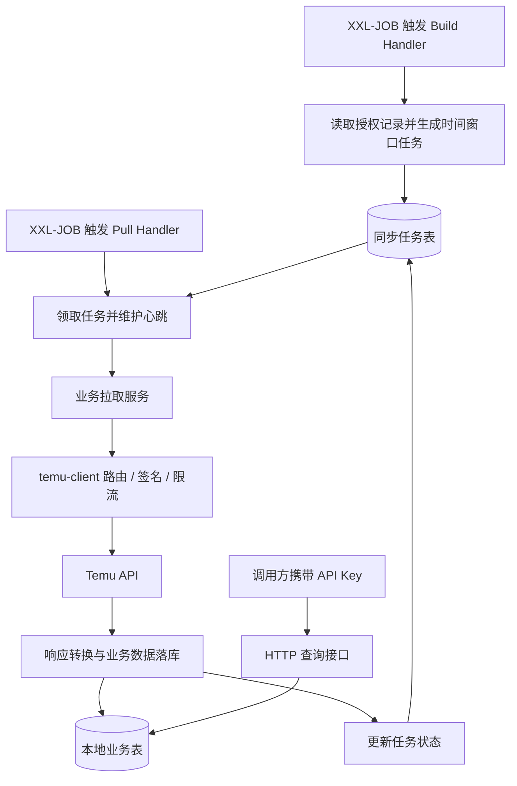

# Badfisher Temu

以 Temu 半托管业务为主的集成后端：围绕订单、售后和仓库同步，提供本地查询、授权维护和任务调度能力；另保留商品、库存及历史金额代码。

> **本项目为纯后端工程，不包含前端页面、前端项目、前端演示数据或可视化管理后台。**
> 数据由 Temu API 同步或通过后端接口维护；仓库不提供真实店铺、订单、密钥或 Token 数据。

当前交付为分阶段改造的后端基线：四模块和公开依赖已完成，Java 8 构建、106 个本地测试通过，47 个外部联调测试默认跳过。店铺身份解耦、任务执行批次保护和完整业务验收仍在后续计划内，详见 [改造进度](docs/REFACTORING.md)。

首次接入请阅读 [Temu 半托管接入与应用开通流程](docs/TEMU_ONBOARDING.md)，其中包含订单与商品两条申请路径、区域入口链接、主体身份选择、运营协作、问卷与白名单、配置迁移、26 个任务入口和验收顺序。已按正文和截图整理两份半托 SOP，注明原文件名与正文标题相反、截图与本本文字混用的问题；“本本”PDF 保留为对应业务模式的参考。原始账号截图不随源码包分发。

## 项目定位与业务能力

Badfisher Temu 面向需要对接 Temu 数据的 Java 后端开发者，可作为 ERP 集成服务或自建管理系统的数据同步后端。它将平台调用、业务存储、任务调度和 HTTP 查询拆开，便于单独复用客户端，或在已有业务模块上继续开发。

以下范围依据当前业务服务与调度入口整理，表示已有代码覆盖，不代表对应区域已经完成真实平台验收。

| 业务 | 当前代码能力 | 已有调度区域 |
| --- | --- | --- |
| 订单 | 父订单、子订单、订单商品、收货地址同步与本地查询；地址补偿 | US / GLOBAL / EU |
| 售后 | 父子售后单、售后商品、退货物流同步与本地查询 | US / GLOBAL / EU |
| 金额（历史代码） | 父子订单金额同步、补偿及单笔拉取；服务已标记弃用，当前平台可用性未确认，不纳入半托默认流程 | 常规 Build/Pull 入口为 US |
| 商品（扩展） | 商品与 SKU 同步、本地列表及详情查询；需单独确认商品授权及半托适用性 | CN（当前代码的商品授权约定） |
| 库存（扩展） | 库存快照同步、查询与历史清理；所用 API 在原枚举中注明全托范围，不作为半托已验证能力 | CN（当前代码的商品授权约定） |
| 仓库 | 仓库信息同步与本地查询 | US / GLOBAL / EU |
| 授权 | 授权记录查询、已有记录的 Token 更新 | 按授权区域维护 |
| 审计与任务 | API 调用日志、统计与清理；同步任务领取、心跳和失败重试 | 随业务入口执行 |

`authRegion` 是授权及 API 路由区域，`site` 是业务站点，两者不能互相替代。GLOBAL 授权下的订单仍需按实际站点归属处理。

“半托”“本本（本地卖家）”“全托”是不同业务模式；账号字段 `type=0/1` 在本工程中仅表示商品/订单授权，不能用来判断业务模式。枚举中列出的发货、面单等 API，也不等于已有完整发货业务链路。

## 工程结构

| 模块 | 职责 |
| --- | --- |
| `temu-client` | 独立 Java 客户端、签名、授权区域路由、平台错误处理；通过 SPI 接入限流和审计 |
| `temu-business` | 按 account/order/aftersales/product/inventory/warehouse/sync/audit 分包，提供业务服务和持久化 |
| `temu-scheduler-xxl-job` | XXL-JOB 2.5.0 Handler 适配，保留 26 个调度入口 |
| `temu-server` | HTTP 接口、API Key 鉴权、启动和配置装配 |

依赖方向为 server → business → client，server → scheduler → business；客户端不依赖 Spring、MyBatis、Redis 或业务 Entity。

业务模块采用“先按业务领域分包，再在领域内分层”的方式，包名前缀为 `com.badfisher.temu.business`：

| 包 | 负责内容 |
| --- | --- |
| `account` | 平台授权记录、Token 维护、GLOBAL 账号与站点解析 |
| `order` | 订单、商品明细、地址和金额的拉取与持久化 |
| `aftersales` | 售后单、售后商品与退货物流 |
| `product` | 商品主数据与 SKU |
| `inventory` / `warehouse` | 库存快照与仓库资料 |
| `sync` | 同步任务模型、任务创建与执行基类、状态操作和重试支持 |
| `audit` | 平台调用日志存储、查询与统计 |
| `infrastructure` | 客户端装配、限流适配、MyBatis 与线程池配置 |

各业务包按需要包含 `model`、`dto`、`mapper`、`service` 等子包；HTTP Controller 集中在 `temu-server`，XXL-JOB Handler 集中在 `temu-scheduler-xxl-job`。新增业务优先放入所属领域，避免重新形成全工程共用的巨型 service 包。

当前分层仍有遗留边界：部分 Controller 直接组织查询，订单与售后拉取服务较大，业务实体仍使用 MyBatis 注解。进一步的查询下沉与服务拆分属于后续改造。

## 数据如何流转

订单、售后、商品和常规金额同步采用任务创建与任务执行两个阶段：



任务状态为 `0 待处理 → 1 执行中 → 2 完成 / 3 失败`，失败任务由重试入口处理。Java 模型已命名为 `SyncTask`，数据库表暂保留 `tb_temu_order_request_task`。库存和仓库使用直接同步入口，不经过上述 Build/Pull 任务链。

每次领取或失败补偿都会生成新的 `execution_id`，并通过数据库时钟维护 10 分钟租约。心跳、完成和失败均校验执行身份及租约；过期租约不能重新续活。平台调用前检查租约，业务写入在同一短事务内锁定并校验任务行，旧执行器失效后停止后续调用和写入。已经发出的 HTTP 请求可能仍会返回，其结果必须通过写库校验才能提交。

GLOBAL 响应必须映射到有效站点及 `channelId`；缺少映射时任务失败并记录业务定位信息，当前页不写入正式业务表。此前已提交的页面保留，补齐映射后可重跑失败任务。

### `channelId` 的业务约定

`channelId` 是由接入方业务维护的店铺级预留标识，与 `shopId` 处于同一业务维度。本工程保留该字段作为订单、售后等数据归属及查询的标识，不新增另一套 `shop_id`，也不要求接入 ERP 服务才能维护它。接入方应为需要店铺归属的授权配置稳定、明确的 `channelId`；`sellerId`、`authRegion` 和 `site` 分别用于平台卖家、请求路由区域和业务站点，不能互相替代。GLOBAL 授权覆盖多个站点时，须分别维护返回站点对应的业务归属。

### 现有数据库升级

新建环境使用 `sql/schema.sql`。已有数据库须先停止全部旧版本执行器并备份，再执行一次 `sql/migrations/20261008_sync_task_execution.sql`，最后启动新版本。迁移保留旧任务及时间窗口，将旧运行中任务转为失败，之后可按需补偿。不能混跑缺少执行身份保护的旧版本，也不能仅依赖 `CREATE TABLE IF NOT EXISTS` 升级现有表。历史空 `channelId` 数据需要按实际归属人工核对，本迁移不自动改写业务归属。

## 后端接口入口

| 路径 | 用途 |
| --- | --- |
| `/temu/access-token` | `GET /list` 查询授权记录，`PUT /update` 更新已有 Token |
| `/temu/order` | 订单聚合详情、父子订单列表、商品明细与地址查询 |
| `/temu/aftersales` | 售后聚合详情、父子售后单、商品与退货物流查询 |
| `/temu/product` | 商品与 SKU 列表及详情查询 |
| `/temu/inventory` | 仓库和库存查询 |
| `/temu/api-log` | API 日志列表、详情与统计 |
| `/temu/api/call` | 可选的平台调用调试入口，默认关闭 |

查询接口读取本地数据库；通用调试接口不承担同步任务创建和业务落库。目前没有新增授权账号的 HTTP 接口、手动同步管理接口或内置 Swagger UI。具体请求字段与返回结构以 `temu-server` 中的 Controller 及对应 DTO 为准。

## 技术基线

- Java 8、Maven 3.6+。
- Spring Boot 2.7.18、XXL-JOB 2.5.0、MyBatis-Plus 3.5.11、MySQL 8。
- OkHttp 3.14.9；Redis 分布式限流和 XXL-JOB 均为可选运行能力。
- Spring Boot 从 2.3.2.RELEASE 升级到 2.7.18，XXL-JOB 从 2.2.0 升级到 2.5.0；编译和运行仍使用 Java 8。
- Spring Boot 2.7.18 已结束开源维护，本次是 Java 8 约束下的兼容升级，不代表获得持续的开源安全更新。
- 使用公开 Maven 依赖，不需要公司父 POM、私有 Starter、SSO、配置中心或 Maven 私服。

## 构建

```shell
mvn clean verify
```

默认禁止真实 Temu 联调测试；测试目录中的历史联调类使用隔离测试账号和数据库时才能人工启用。

## 本地运行

1. 在独立 MySQL 8 数据库执行 `sql/schema.sql`。该脚本仅创建结构，不导入真实业务数据。
2. 设置 `DB_URL`、`DB_USERNAME`、`DB_PASSWORD`。
3. 设置至少 32 字符的随机 `TEMU_API_KEY`；未设置时启动失败，避免默认公开管理接口。
4. 执行 `java -jar temu-server/target/badfisher-temu.jar`。

服务默认监听 8080。业务请求携带 `X-Api-Key` 请求头；`GET /actuator/health` 允许匿名访问且不返回连接细节。
API Key 代表整个服务的调用权限，不提供用户登录、角色管理或多租户权限隔离。公网部署应由 HTTPS 反向代理保护。

### 从启动服务到同步数据

默认数据库只有表结构，平台路由为空，XXL-JOB 关闭；因此服务启动后不会自动拉取订单，也没有用于展示的前端数据。

开展业务联调前需要准备：

1. 在自己的数据库中维护有效授权记录，包括应用、卖家、授权区域和平台凭证；当前接口只能维护已有 Token，账号初始化须由接入方完成。
2. 为对应应用与授权区域配置平台路由，并确认最终访问 Temu 的固定公网出口 IP 已在对应应用的白名单中。订单等业务按上述约定维护店铺级 `channelId`。
3. 启用并连接兼容的 XXL-JOB Admin，在 Admin 配置需要的 Handler 和调度参数。任务型业务分别安排 Build 与 Pull 入口，仓库和库存使用各自的直接同步入口。
4. 在隔离环境完成真实平台拉取，核对任务状态、API 日志和本地数据，再通过 HTTP 查询接口验收。

平台路由通过外部 YAML 配置，例如：

```yaml
temu:
  api:
    routes:
      demo-app:
        US:
          order-url: ${TEMU_DEMO_US_ORDER_URL:}
```

路由中的应用名称必须与授权记录的 `appId` 一致。授权区域 `authRegion` 与业务站点 `site` 分别配置；GLOBAL 授权可覆盖多个站点。

### 固定出口、白名单与区域路由

来源环境使用不同主体、不同区域的代理 URL 对接 Temu。`order-url` 和 `partner-url` 是客户端实际发送 HTTPS 请求的完整目标地址，不是 JVM 的通用 HTTP 代理设置。

路由按 `授权记录 appId → authRegion → API 授权类型` 选择：订单类接口使用 `order-url`，商品类接口使用 `partner-url`。同一个区域下，两类接口可使用不同代理；不同应用主体也可使用不同出口。不能仅根据业务站点，或根据代理域名中的 US/GLOBAL 字样推断最终区域。

```text
业务服务 → 对应主体和授权区域的代理 URL → 固定公网出口 IP → Temu 对应接口
```

部署时，需要在 Temu 对应应用的管理侧配置实际出口 IP 白名单，并确认代理的上游地址、区域、证书和出网链路。业务服务的内网地址、代理域名解析地址、YAML 注释中的 IP，都不能单独证明 Temu 实际看到的出口 IP。若使用直连地址，则需确认业务服务经 NAT 等网络设施后的实际出口 IP 已获准。

新工程保留了按主体和授权区域选择路由的逻辑。缺少主体、区域或对应类型的 URL 时会报错，不自动回退到其他主体、其他区域或平台直连地址。白名单登记和代理部署由运行环境负责，应用配置本身不会开通白名单。

可参考 [多主体区域配置示例](deploy/application-temu.example.yml)。复制到工程外的私有配置文件，替换示例应用名称，填写经确认的路由环境变量，然后显式加载：

```shell
java -jar temu-server/target/badfisher-temu.jar --spring.config.additional-location=file:/absolute/path/application-temu.yml
```

Windows 可使用 `file:E:/private-config/application-temu.yml`。示例只提供配置结构，没有真实路由和平台凭证，不能直接用于同步。授权记录中的 `appId` 必须与 YAML 的第一层路由 key 完全一致。

### 原环境 YAML 的迁移对应关系

| 原配置 | 新工程对应方式 |
| --- | --- |
| `server.port` | 仍有效，也可通过 `SERVER_PORT` 设置 |
| `spring.datasource.url/username/password` | 仍有效；默认配置通过 `DB_URL/DB_USERNAME/DB_PASSWORD` 注入 |
| `spring.datasource.type`、`spring.datasource.druid.*` | 新工程使用 Hikari，不能沿用 Druid 类型和参数；连接池参数改用 `spring.datasource.hikari.*` |
| `spring.redis.*`、Lettuce 连接池 | 新限流适配器绑定 `temu.client.redis-address/redis-password`；使用 `redis` 限流模式时配置 `REDIS_ADDRESS/REDIS_PASSWORD`，旧 Lettuce 参数不生效 |
| `xxl.job.*` | 改为 `temu.scheduler.*`，详见配置示例；Admin 接入目标为 2.5.0 |
| `temu.api.routes` | 保留结构；按实际授权记录迁移主体、区域、`order-url` 和 `partner-url` |
| 原 MyBatis 别名包、Mapper 路径 | 新包名为 `com.badfisher.temu`，Mapper 路径为 `classpath*:/mapper/**/*.xml`；不要覆盖为原工程路径 |
| `security.oauth2.*`、`ignore.urls` | 新工程采用 `TEMU_API_KEY`；旧登录服务和接口放行配置不生效 |
| `feign.*` | Temu 客户端使用 OkHttp，超时配置为 `temu.client.*-timeout-seconds` |
| `swagger.*` | 当前没有 Swagger UI，旧开关不提供文档页面 |

来源数据库连接使用 `Asia/Shanghai`，新工程示例连接使用 `UTC`。接入历史数据库时，需按原字段语义核对 JDBC、数据库会话和业务时间窗口，不能直接把原连接时区替换为 UTC。JSON 输出时区由 `spring.jackson.time-zone` 单独控制。

默认 `TEMU_RATE_LIMIT_MODE=local`，仅适用于单实例。多实例须使用 `redis` 模式并提供 `REDIS_ADDRESS` 和必要的 `REDIS_PASSWORD`，所有实例共享同一 Redis 和应用限流键。
限流等待失败或 Redis 异常均阻止当前 HTTP 请求，不自动绕过平台限额。
客户端对审计回调的运行时异常统一隔离，审计失败不覆盖成功响应、平台业务错误或原始 IO 异常；审计仍同步执行，其耗时计入调用延迟。

XXL-JOB 默认关闭。启用时设置 `XXL_JOB_ENABLED=true`、`XXL_JOB_ADMIN_ADDRESSES`、`XXL_JOB_ACCESS_TOKEN`，接入目标为 XXL-JOB Admin 2.5.0；Admin 与执行器的 Access Token 必须一致。

### XXL-JOB 升级接入说明

26 个 Handler 的注册名称保持不变，入口改为 `public void method()`。调度参数从 `XxlJobHelper.getJobParam()` 获取，执行结果通过 `XxlJobHelper.handleSuccess/handleFail/handleResult` 写入上下文。既有任务参数格式保留，不能再依赖旧式 `ReturnT<String> method(String param)` 接收调度参数和回传状态。

本仓库仅提供执行器，不包含 Admin 服务或 Admin 数据库升级脚本。已有 2.2.0 Admin 的环境应先备份 Admin 数据库，按照官方版本说明完成独立调度中心升级，再在隔离环境验证执行器注册、任务参数、成功/失败回调和日志查询。本地方法适配测试不代表远端 Admin 联调已通过。

本次已迁移调度协议并加入执行身份及租约保护；业务内部自行捕获异常后的失败汇总、任务创建幂等仍属于 [待完成的业务调整](docs/REFACTORING.md)。

通用平台调试接口 `/temu/api/call` 默认关闭，仅在显式配置 `temu.api.debug-enabled=true` 时注册，并仍要求 API Key。
API 日志清理默认保留一个月，可通过 `temu.maintenance.api-log-retention-months` 调整。

Docker Compose 示例位于 `deploy/compose.yml`，运行前设置 `DB_PASSWORD`、`MYSQL_ROOT_PASSWORD` 和 `TEMU_API_KEY`：

```shell
docker compose -f deploy/compose.yml up --build
```

该示例只启动 MySQL 和后端服务，不包含前端。初始化 SQL 仅在数据库卷首次创建时执行。

## 业务与发布边界

当前适合继续开发、代码评审和搭建隔离联调环境。Java 8 构建、本地测试及 H2 启动与鉴权已有验证记录；实际 MySQL、Redis、多实例任务、Temu API、XXL-JOB Admin、Docker 和远端 CI 尚未验收。

店铺级身份继续使用业务维护的 `channelId`。后续处理任务创建幂等和失败结果反馈，并完成真实数据库、多实例及完整同步链路验收。开源许可证与公开发布尚未确定。

本仓库从既有业务实现独立整理，原作者标记予以保留。当前版本的完成情况、后续模型调整和验证边界见 [改造进度](docs/REFACTORING.md)。
在所有阶段验收前，不应把分包和编译成功理解为真实店铺同步、生产部署或公开发行已经验证。
