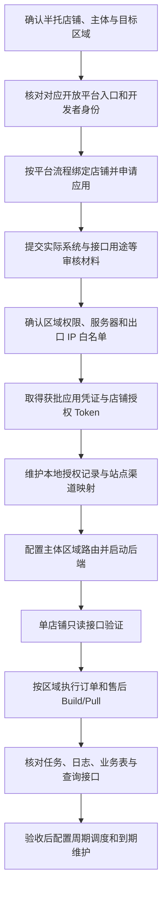

# Temu 半托管接入与应用开通流程

本工程以半托管的订单、售后、仓库数据同步为主。**纯后端，没有前端页面、前端项目或前端演示数据。** 本文把平台开通、运行环境和现有代码连接起来，不代表平台申请已提交、权限已获批或真实链路已验收。

## 1. 先明确资料与业务模式

本文依据当前源码、建表 SQL、来源环境的区域代理配置，以及接入方提供的两份 Word SOP 和 PDF 整理。资料核对日期为 2026-10-08，未登录平台验证页面是否更新。原始资料存在文件名与内容不一致，以下按正文和截图归类，保留原文件名便于追溯。

| 来源编号 | 原文件名 | 正文和截图核对结果 | 本文用途 |
| --- | --- | --- | --- |
| S1 | `TEMU-订单类应用申请-sop.docx` | 正文标题为“商品自研应用申请”，入口是 `partner.kuajingmaihuo.com`，含“查看商品”和联系运营材料；另混有跳转美区截图 | 商品申请路径参考，不能仅按文件名归为订单 |
| S2 | `TEMU-商品类应用申请-sop.docx` | 正文标题为“订单自研应用申请（美/欧/全球区）”，有区域订单网关和大陆/香港卖家截图；文字仍夹有本本选项 | 订单区域申请路径参考，身份选择以实际主体核对 |
| S3 | `官方temu-sop.pdf` | 共 10 页，标题为“本本美/欧区自研应用申请 SOP”；SHA-256 比对与先前的 `本本及其欧美授应用开通流程.pdf` 完全一致 | 本本参考资料，不因文件名含“官方”就当作半托专属规则 |

两份 Word 是接入方整理的操作资料；其中“最新指南”“1～2 工作日”等表述不代表本次已核实的平台现行规则。原文件和截图不放入开源工程，本文仅整理必要流程和公开入口。

| 范围 | 本文如何使用 |
| --- | --- |
| 半托管 | 本工程主流程；具体申请入口、权限与审核材料以实际半托店铺后台为准 |
| 本本/本地卖家 | PDF 中的申请步骤、页面选项及区域链接作为有明确来源的参考，不直接宣布对半托适用 |
| 全托 | 源码中部分 `bg.btg.goods.stock.*` 等接口被注释为全托；它与本本也不是同一种模式 |

S2 已提供区域平台身份与业务类型截图，可以补充对应操作路径，但没有覆盖半托申请全过程。不能据此承诺审批时长、配额或固定 Token 有效期。代码中的 `type=1` 是订单授权、`type=0` 是商品授权，不是半托/本本/全托标志。`authRegion=CN` 是当前商品授权的代码约定，也不能代替业务模式判断。

## 2. 平台入口与接口文档链接

订单区域链接依据 S2 的“申请入口”“API 接口请求 URL”，并与 S3 第 1、10 页交叉核对。使用半托账号时，还需在实际后台确认店铺模式和权限。它们不是已验证可用于任意应用的默认配置。本次没有登录这些平台或发送平台 API 请求。

| 区域 | Partner 平台入口 | 资料列出的订单网关 |
| --- | --- | --- |
| US | [美国 Partner（S2）](https://partner-us.temu.com/global)，[首页（S3）](https://partner-us.temu.com/) | `https://openapi-b-us.temu.com/openapi/router` |
| GLOBAL | [Global Partner](https://partner.temu.com/) | `https://openapi-b-global.temu.com/openapi/router` |
| EU | [欧洲 Partner](https://partner-eu.temu.com/) | `https://openapi-b-eu.temu.com/openapi/router` |

资料将 Global 描述为美国和欧区之外的区域。US 链接中的 `/global` 是页面路径，不表示授权区域为 GLOBAL。具体国家能否申请、当前店铺属于哪个授权区域，需在目标应用中确认；不要根据业务国家字符串自行换区域。上述网关用于对照代理上游，不能直接替换已配置的固定出口代理。

商品申请相关入口来自 S1：

- [商品申请资料中的 Partner 登录入口](https://partner.kuajingmaihuo.com/login?redirectUrl=https%3A%2F%2Fpartner.kuajingmaihuo.com%2F)
- [入驻与绑定说明](https://agentpartner.temu.com/document?cataId=875196199516&docId=903508418346)：S1 注明需注册登录后查看，API 文档需入驻或绑定后查看。
- [应用管理页面](https://agentpartner.temu.com/main/application-manage)：来自 S1 截图；截图显示“暂无应用，请联系运营”，不是商品 API 请求地址。

Partner 登录、应用管理、API 网关是三类地址。不要把网页登录 URL 填入 `order-url` 或 `partner-url`。S1 未提供可确认的商品 API 网关，应在获批应用文档中取得，并核实代理上游后填写。

来源工程 README 还保留以下文档链接，可能需要登录，目录参数的当前有效性未验证：

- [开放平台文档入口](https://partner-us.temu.com/documentation?menu_code=fb16b05f7a904765aac4af3a24b87d4a/)
- [订单 API 文档](https://partner-us.temu.com/documentation?menu_code=fb16b05f7a904765aac4af3a24b87d4a&sub_menu_code=554fd46b45ee49269cbdd6d4008a5dc1)
- [售后 API 文档](https://partner-us.temu.com/documentation?menu_code=fb16b05f7a904765aac4af3a24b87d4a&sub_menu_code=8b7b98c50ba04d5ab96d17b5c4d2410f)

如果历史目录链接失效，从对应区域平台首页进入 API 文档，搜索下文列出的准确 `type`，再核对账号模式、授权范围和请求字段。当前材料未确认半托卖家中心的独立登录 URL、商品 API 网关或授权码换 Token 的 URL，本文不填造这些地址。

## 3. 开通到同步的整体顺序



### 步骤一：准备店铺和申请材料

由店铺负责人确认经营模式为半托，列明店铺/卖家标识、申请主体、实际销售站点、需要的数据范围，以及谁负责平台账号和授权操作。

准备实际系统名称、业务用途、接口清单和部署情况。只管理自身店铺时，核对平台提供的自研应用路径；为其他商家提供服务时，核对 ISV/服务商路径。开源代码本身不等于已获得服务商资质，也不决定应选择哪种申请身份。

S1/S2 要求原团队在对应主体的 VPS 浏览器中操作。这是该团队的账号和操作环境约定，不是本次核实的平台普遍要求。沿用该环境时应由账号负责人使用对应主体的受控浏览器，避免串号；浏览器登录环境与后端 API 出口白名单仍需分别核对。

S1/S2 均记载：绑定为必需步骤，使用卖家中心主账号；同一卖家中心账号与 Partner 的绑定具有唯一性，已有应用时可能直接进入首页，Partner 可管理多个店铺。实施前先由运营检查已有账号、应用与店铺绑定，避免重复注册。不要把资料中的“一个自研应用”自行推断成所有区域、订单和商品类型共用一个应用；具体约束以目标后台为准。

### 步骤二：申请应用与数据权限

在经确认的半托平台路径完成开发者注册、店铺绑定、应用信息和当前要求的问卷。申请说明应围绕实际使用：订单同步、必要的收货信息、售后与退货物流、仓库查询。商品、库存和金额权限单独核对，不因为源码存在相关枚举就全部申请或启用。

#### 订单类申请路径

依据 S2 的正文和三张截图，按以下顺序操作：

1. 按 US、EU 或 GLOBAL 进入相应 Partner，注册或登录该区域账号。S2 说明区域账号独立，不应直接复用其他区域的授权请求。
2. 自有系统服务自有店铺时，截图中的身份是 `Local/Cross-border Seller`；`Third-Party Software Provider` 是另一种身份。S3 的旧资料写作 `Self-developed application seller`，应按当前页面含义确认，不能仅机械匹配旧按钮名。资料记载角色选定后不能修改，选择前核实用途。
3. 按真实注册主体选择业务类型。S2 截图选中的是 `Sellers registered in Chinese Mainland or Hong Kong SAR`；另一选项是 `Sellers registered in applicable countries or regions`。大陆/香港主体据此核对跨境路径，不能照搬 S2 正文残留的“本本卖家点击 `You are a local seller`”。半托经营模式和主体注册地是不同维度，仍需核实当前店铺可绑定范围。
4. 完成卖家中心主账号授权绑定，核对目标 Shop ID、应用和所属区域。
5. 填写应用信息、真实系统截图及所需接口用途。S2 将测试网址、账号和密码列为选填，当前表单若不同则按实际要求处理。
6. 填写安全与合规问卷，登记实际服务器、云厂商和出网 IP；材料由运营与技术共同核对后提交。步骤三给出字段检查表。
7. 跟踪应用表单与问卷审核状态；驳回时按具体原因补正。通过后查看应用 Key/Secret，确认店铺绑定、地区权限和 IP 生效，再按平台实际方式取得授权 Token。

#### 商品类申请路径

依据 S1 的正文及入口截图，商品申请单独跟进：

1. 从上文商品申请 Partner 入口登录或注册，核对账号主体及现有应用，完成平台要求的卖家绑定。
2. 准备店铺 ID、应用名称、自研系统截图、商品接口用途说明、其他平台上的实际应用截图；S1 将其他平台店铺链接标为可不填。适用材料以运营反馈和实际表单为准。
3. S1 记载由 Temu 运营协助申请，应用管理截图显示“暂无应用，请联系运营”。遇到这一状态时交由对应运营核实开通方式，不把另一个区域的注册步骤当作替代。
4. 按实际要求提交应用与合规材料，跟踪审批和店铺绑定；获批后获取本应用的凭证及可用 API 文档，确认商品网关和授权范围。
5. 映射到本工程的商品授权 `type=0`、当前 `authRegion=CN` 和 `partner-url`，先做有权限的商品只读验证，再启用商品任务。CN 是代码约定，不证明该应用可以跨区域请求订单，也不证明现有库存接口适用于半托。

S1 混有“跳转 Partner Platform（美区）”截图，本文不据此认定商品申请必须跳转美区；实际跳转和应用归属需由平台页面确认。

两份 SOP 提到约 1～2 个工作日审核、店铺绑定约 1 个工作日。这是资料记载的参考时间，不作为平台 SLA 或项目上线承诺。S2 记载审核后可添加地区、店铺和 IP；店铺未关联时由运营协助核实，不把“自动关联所有店铺”当作已经生效的结果。

本项目没有可视化后台，不能把接口工程描述成已有管理页面；若审核要求系统演示，应提供真实接入系统的材料，是否接受 API 演示需向平台确认。

### 步骤三：核对区域、实际部署和白名单

为每个“应用主体 + 授权区域 + 接口类型”记录以下对应关系，保存到自己的私有运维资料：

| 信息 | 需要核对的内容 |
| --- | --- |
| 平台授权 | 业务模式、获批应用、店铺、数据国家/地区、接口权限 |
| 路由 | 配置 key、`authRegion`、订单或商品接口、代理的完整 URL |
| 代理上游 | 实际转发到的平台网关及对应区域，保持请求体和签名一致 |
| 出口 | Temu 实际看到的公网源 IP；NAT 或代理之后的地址可能与服务本机不同 |
| 白名单 | 在对应应用中登记实际出口 IP，保存审批/生效状态 |
| 数据处理 | 真实的处理和存储位置、云服务商、访问控制及加密能力 |

```text
后端服务 → 应用/区域专属代理 → 实际公网出口 IP → Temu 对应区域网关
```

来源 YAML 的代理地址和固定 IP 注释说明了部署意图，不能证明代理当前出口或平台白名单仍有效。仅改 DNS、路由字符串或 YAML 注释，不会变更 Temu 的批准范围。旧 `ignore.urls` 只是原服务自身的接口放行配置，与 Temu 的 IP 白名单无关。

S2 的 Q1～Q5 与 S3 第 5～7 页均记载主体、数据地区、服务器地区、云厂商、IP 与加密要求。S2 混有本本内容，以下用于半托提交前核对，不替代当前表单：

| 材料中的问项 | 提交前的核对方式 |
| --- | --- |
| Q1 公司国家/地区 | 与真实主体和卖家中心 DPA 签署主体一致；不能把 S2 总结中的“中国香港”当作所有账号的固定答案 |
| Q2 服务或数据授权国家/地区 | 核对当前平台问题的原文，按实际业务和区域申请；资料要求与 Partner 区域一致，新增国家仍需获批 |
| Q3 个人信息处理服务器所在地 | 如实记录处理与存储设施；资料写明仅支持非中国云服务商和区域限制，须结合半托当前问卷确认 |
| Q4/Q5 云服务商与 IP | 与申报服务器和 Temu 看到的出口对应；资料允许多个 IP，仅已批准 IP 可请求 |
| 安全问卷 | 按要求提供真实敏感信息加密存储能力及证据，S2 建议 AES；不能用普通界面截图或日志脱敏替代 |
| 跨境传输材料 | S3 提及特定传输场景的 DPF/TIA；按真实数据流和当前问卷判断适用性，不把资料的“非必填”理解为适用时也可跳过 |

使用境外出口代理不能把实际位于其他地区的数据存储或处理设施申报成代理所在地。

项目已有日志脱敏，但授权表存储凭证、地址表保存业务字段，不能把脱敏功能当作已完成数据库加密的证明。问卷中填写的能力须有实际部署证据。PDF 第 7 页将 Base64 描述为哈希算法有误：Base64 是编码，既不是加密，也不是哈希。

### 步骤四：取得并维护平台凭证

按平台实际授权流程取得应用 Key、Secret 和店铺授权 Token，确认它们属于同一应用及正确区域。Token 的获取方式、有效期和续期方式以实际应用说明为准；当前仓库没有授权跳转、回调、授权码兑换或自动续期的完整实现。

本地 `PUT /temu/access-token/update` 只把已经取得的新 Token 保存到数据库，不会向 Temu 换取或续期 Token。更新时本地过期时间按“当前服务器时间 + expireDays”计算，调用方必须使用平台允许的有效期限；不能把表结构的默认 320 天当作平台承诺。

更新商品授权（`type=0`）时，当前服务会强制把 `authRegion` 设为 `CN`；它不是任意区域的商品授权管理接口。接入其他商品授权区域前，需要单独确认平台契约并调整相应代码。

### 步骤五：初始化本地数据与主体映射

在独立数据库执行 [schema.sql](../sql/schema.sql)。脚本创建的是 `badfisher_temu`，只有结构，没有真实授权和订单数据；不要直接把初始化脚本当作现有生产库的迁移脚本运行。

首次授权记录由接入方通过受控的数据库管理或自有初始化流程创建，当前没有新增账号 HTTP 接口。表为 `tb_temu_access_token`，字段含义如下：

| Java / SQL 字段 | 当前代码中的用途 |
| --- | --- |
| `appId / app_id` | 配置路由和限流使用的主体 key。来源 SQL 注释为公司主体简写；它必须匹配 YAML 路由 key，不能与平台 `appKey` 混填 |
| `appKey / app_key` | 实际请求中的 `app_key` |
| `appSecret / app_secret` | API 签名所用 Secret |
| `sellerId / seller_id` | 当前业务使用的卖家授权标识；需核实与平台店铺标识的映射，不直接将 PDF 的 shopid 当作它 |
| `site` | 业务站点，例如 US、AU、CA，用于数据归属 |
| `authRegion / auth_region` | 授权和请求路由区域 US/GLOBAL/EU/CN |
| `type` | `1` 订单授权，`0` 商品授权 |
| `channelId / channel_id` | 当前订单类业务依赖的 ERP 店铺渠道编号；框架独立店铺身份仍待改造 |
| `accessToken / access_token` | 平台已经签发的有效 Token |
| `expireDays / expire_days`、`expireTime / expire_time` | 本地有效期管理；`expireTime` 为空时，本地不拦截过期，不代表平台永不过期 |
| `delFlag / del_flag` | `0` 表示有效记录，`1` 表示逻辑删除 |

GLOBAL 可以是一次请求覆盖多个业务站点：相同 `appId + sellerId + authRegion + type` 的记录共用请求凭证，站点分别映射到各自的 `channelId`。Build/Pull 会按请求身份去重；同一请求身份的 Key、Secret、Token 不一致会报错。

当前 `TemuGlobalAccountResolver` 对缺失站点映射的数据会记录警告并以空 `channelId` 继续处理。验收时必须核对所有实际出单站点的映射，不能仅凭任务显示完成认为数据归属正确。一个身份有多条站点记录时，更新 Token 接口按单条 ID 修改，需维护全部相关记录的一致性。

### 步骤六：配置与启动后端

运行基线为 Java 8、Spring Boot 2.7.18、MySQL 8；调度使用 XXL-JOB 2.5.0。构建与环境变量见 [README](../README.md)，区域配置见 [application-temu.example.yml](../deploy/application-temu.example.yml)。

配置时先填写数据库和 `TEMU_API_KEY`，再配置经确认的主体/区域代理 URL。需要 Redis 限流时设置 `TEMU_RATE_LIMIT_MODE=redis` 和 Redis 连接信息；首轮连通性验证先保持 `XXL_JOB_ENABLED=false`，避免尚未核对时间窗口就触发批量同步。

`TemuApiUrlRouter` 按 `appId → authRegion → API AccountType` 选择目标：订单授权使用 `order-url`，商品授权使用 `partner-url`。缺配置直接失败，没有自动直连或跨区域回退。旧 Druid、Lettuce、SSO、MyBatis 路径和 `xxl.job.*` 的迁移对应表见 README。

### 步骤七：单店铺验证后再启用调度

先确认 `/actuator/health` 正常，并携带 `X-Api-Key` 调用 `GET /temu/access-token/list` 核对主体、区域、站点、授权类型及过期状态。`TEMU_API_KEY` 是访问本后端的密钥，与 Temu 的 `access_token` 是两种凭证。

在已确认白名单、权限和参数后，选择只读订单或仓库接口验证。若使用通用调试入口，需显式启用 `temu.api.debug-enabled=true`；它会发出真实平台请求，不会替代业务同步和落库。联调结束后关闭此入口。

例如以下是依据现有订单请求构造器整理的调试请求体，仅含占位信息；时间戳需替换成平台允许的小范围秒级窗口：

```json
{
  "appId": "demo-app-a",
  "sellerId": "demo-seller",
  "site": "US",
  "authRegion": "US",
  "accountType": 1,
  "type": "bg.order.list.v2.get",
  "pageNumber": 1,
  "pageSize": 10,
  "updateAtStart": 0,
  "updateAtEnd": 0
}
```

提交到 `POST /temu/api/call`，请求头仍需 `X-Api-Key`。`0` 是待替换占位值，不能原样用于真实联调。客户端会从授权记录取凭证并计算签名，正文不需要自行放置 Secret 或 Token。

确认 HTTP 响应、平台业务结果和返回范围都正确后，再连接 Admin 2.5.0、配置执行器及对应区域的任务。调度频率和批量大小按实际限流、数据量与执行时长确定，本文不把示例频率当作已验收参数。

## 4. 当前半托主线实际调用的 API

| 业务 | 当前服务实际使用的 API type | 接入时要确认 |
| --- | --- | --- |
| 订单列表与明细入库 | `bg.order.list.v2.get` | 订单查询权限、更新时间窗口、分页范围 |
| 收货地址 | `bg.order.shippinginfo.v2.get` | 收货信息权限及订单状态允许的读取范围 |
| 父售后列表 | `bg.aftersales.parentaftersales.list.get` | 对应区域售后权限 |
| 子售后列表 | `bg.aftersales.aftersales.list.get` | 子售后数据范围 |
| 父售后详情 | `temu.aftersales.parentaftersales.detail.get` | 详情权限及当前接口可用性 |
| 退货物流 | `bg.aftersales.parentreturnorder.get` | 退货物流数据权限 |
| 仓库 | `bg.logistics.warehouse.list.get` | 仓库查询权限 |

订单服务从列表响应拆分落库；枚举中的 `bg.order.detail.get` 不表示订单主流程一定调用了详情接口。枚举还保留发货、面单、商品编辑和消息订阅等 type，当前未找到相应的完整发货业务服务或消息接收闭环，不能把“列有枚举”当成“业务已经实现”。

扩展能力单独处理：商品拉取使用 `bg.glo.goods.list.get`；库存拉取使用 `bg.btg.goods.stock.quantity.get`，后者在原枚举中注明全托范围。金额服务调用 `bg.order.amount.query`，源码已 `@Deprecated` 并注明平台不再开放，本次未向平台核实状态。上述扩展不放入半托默认开通与验收路径。

## 5. XXL-JOB 入口与执行顺序

下表列出当前 26 个 Handler。所有任务均需在外部 Admin 配置；应用默认关闭 XXL-JOB，也不会自动创建 Admin 任务。Build 与 Pull 的参数当前未用于控制店铺或时间窗口，不能通过随意填写调度参数实现单店铺执行。

| Handler | 作用与先后关系 | 调度参数 / 范围 |
| --- | --- | --- |
| `temuUsOrderBuildJob` | US 订单创建任务 | 无 |
| `temuUsOrderPullJob` | 消费 US 订单任务 | Build 后执行，无参数 |
| `temuGlobalOrderBuildJob` | GLOBAL 订单创建任务 | 无 |
| `temuGlobalOrderPullJob` | 消费 GLOBAL 订单任务 | Build 后执行，无参数 |
| `temuEuOrderBuildJob` | EU 订单创建任务 | 无，仅在 EU 授权与出口确认后启用 |
| `temuEuOrderPullJob` | 消费 EU 订单任务 | Build 后执行，无参数 |
| `temuUsAftersalesBuildJob` | US 售后创建任务 | 无 |
| `temuUsAftersalesPullJob` | 消费 US 售后任务 | Build 后执行，无参数 |
| `temuGlobalAftersalesBuildJob` | GLOBAL 售后创建任务 | 无 |
| `temuGlobalAftersalesPullJob` | 消费 GLOBAL 售后任务 | Build 后执行，无参数 |
| `temuEuAftersalesBuildJob` | EU 售后创建任务 | 无，仅在 EU 授权与出口确认后启用 |
| `temuEuAftersalesPullJob` | 消费 EU 售后任务 | Build 后执行，无参数 |
| `temuUsWarehousePullJob` | US 仓库直接同步 | 无，不经过任务表 |
| `temuGlobalWarehousePullJob` | GLOBAL 仓库直接同步 | 无，不经过任务表 |
| `temuEuWarehousePullJob` | EU 仓库直接同步 | 无，不经过任务表 |
| `temuAddressRemediationJob` | 已有订单地址补偿 | 空值扫描启用账号；或 `channelId:parentOrderSn,...` |
| `temuFailedTaskRetryJob` | 重跑指定失败任务 | 任务 ID，例如 `123,124`；仅针对失败状态 |
| `temuApiLogCleanupJob` | 清理 API 日志 | 无，默认保留一个月，可配置 |
| `temuCnProductBuildJob` | 商品扩展创建任务 | 无，先确认商品授权与业务适用性 |
| `temuCnProductPullJob` | 商品扩展消费任务 | 商品 Build 后执行 |
| `temuCnStockPullJob` | 库存扩展直接同步 | 无，依赖已同步的商品；不纳入默认半托链路 |
| `temuStockSnapshotHistoryCleanJob` | 清理库存历史快照 | 无，启用库存扩展后按需安排 |
| `temuUsOrderAmountBuildJob` | 历史金额任务构建 | 不作为默认启用项 |
| `temuUsOrderAmountPullJob` | 历史金额任务消费 | 不作为默认启用项 |
| `temuOrderAmountRemediationJob` | 历史金额批量补偿 | 空值或 `appId\|authRegion`，代码仅支持 US |
| `temuOrderAmountSinglePullJob` | 历史金额按订单补偿 | `sellerId:parentOrderSn,...`，代码仅支持 US |

首次启用前务必检查当前构建逻辑：`AbstractTemuBuildJob` 无历史任务时从 **2024-01-01 00:00:00（Asia/Shanghai）** 构建到当前时间，并非默认只拉取最近一天。已完成窗口下一次重叠 2 分钟；10 分钟无有效心跳的执行中任务可能被回收。当前没有通过 YAML 设置首次起点的能力。

因此首轮验证宜在仅配置目标账号的隔离环境进行，先检查生成的任务窗口，再执行 Pull。不要把尚未验收的历史全量范围直接交给生产周期调度。后续要改变初始窗口，应单独修改、回归；本文没有代替业务修改。

任务型同步的数据库状态是 `0 待处理 → 1 执行中 → 2 完成 / 3 失败`。XXL-JOB 层已迁移到 2.5.0 结果协议，但部分业务内部捕获异常后的汇总仍不完整；不能只凭 Admin 显示成功判断所有业务记录都成功。

## 6. 落库、查询与验收

| 验收对象 | 当前证据入口 | 通过条件 |
| --- | --- | --- |
| 后端启动 | `GET /actuator/health` | 健康检查正常；不代表平台权限通过 |
| 授权配置 | `GET /temu/access-token/list` | 主体、卖家、区域、类型、站点、有效期与实际一致 |
| 平台请求 | `GET /temu/api-log/list`、`tb_temu_api_log` | 目标 URL、API type、业务成功标志和数据范围正确 |
| 同步任务 | `tb_temu_order_request_task` | 对应窗口最终完成；失败原因可定位，无遗留执行中任务 |
| 订单 | `/temu/order/parent/list`、`/temu/order/detail/{parentOrderSn}` | 父单、子单、商品、地址与源数据一致 |
| 售后 | `/temu/aftersales/parent/list`、`/temu/aftersales/detail/{parentAftersalesSn}` | 父子售后、商品、退货物流对应正确 |
| 仓库 | `/temu/inventory/warehouse/list` | 对应卖家和仓库数据一致 |
| GLOBAL 归属 | 业务表的 `site`、`channel_id` | 每个出单站点有正确映射，无异常空渠道记录 |
| 重跑 | 同一窗口的任务与业务表 | 数量与业务唯一键符合预期，未产生重复或覆盖错误 |

订单主要涉及 `tb_temu_parent_order`、`tb_temu_children_order`、`tb_temu_order_product`、`tb_temu_order_address`；售后涉及 `tb_temu_parent_aftersales`、`tb_temu_children_aftersales`、`tb_temu_aftersales_product`、`tb_temu_aftersales_return_logistics`；仓库为 `tb_temu_warehouse`。详细字段和索引以建表 SQL 为准。

路由匹配或限流阶段失败可能发生在 HTTP 请求和 API 审计入库之前，此时同时检查服务日志。HTTP 200 也可能包含平台业务错误；API 调用成功又不等于业务转换与数据库事务成功，应按上表逐层核对。

## 7. 后续维护和未完成边界

| 事项 | 当前处理方式与边界 |
| --- | --- |
| Token 到期 | 平台侧按实际方式重新获取；本地按授权记录 ID 更新，确保同身份多站点记录一致；无自动续期闭环 |
| 新增区域/站点 | 先取得实际权限，再准备区域出口、路由和站点渠道映射；新增 YAML 节点不会取得平台权限 |
| 更换出口 IP | 平台批准新 IP 后再切流，保留原环境用于回退；不能仅修改代理 DNS |
| Admin 升级 | 对接 2.5.0；既有 Admin 数据库需由部署方备份并按官方流程升级 |
| 任务并发 | 执行批次隔离、任务创建幂等及部分失败汇总仍在改造计划内 |
| 数据保护 | 日志脱敏已有实现；字段加密、保留期限及问卷材料须与实际部署一致 |
| 平台审核 | 仓库没有申请自动化和管理页面；文档不能代替平台批准 |

当前已有 Java 8 编译、106 个本地测试及 H2 启动/鉴权验证记录。47 个外部测试默认跳过，真实 MySQL、Redis、多实例、Temu 和 XXL-JOB Admin 联调尚未完成。本次流程整理没有发送 Temu 请求或修改平台白名单。

## 8. 阅读源码的位置

- [授权实体及字段](../temu-business/src/main/java/com/badfisher/temu/business/account/model/TemuAccessToken.java)
- [Token 更新行为](../temu-business/src/main/java/com/badfisher/temu/business/account/service/impl/TemuAccessTokenServiceImpl.java)
- [主体/区域/接口路由](../temu-client/src/main/java/com/badfisher/temu/client/TemuApiUrlRouter.java)
- [签名与请求客户端](../temu-client/src/main/java/com/badfisher/temu/client/TemuApiClient.java)
- [API type 与授权类型](../temu-client/src/main/java/com/badfisher/temu/client/enums/TemuApiType.java)
- [任务窗口构建](../temu-business/src/main/java/com/badfisher/temu/business/sync/execution/AbstractTemuBuildJob.java)
- [任务领取与心跳](../temu-business/src/main/java/com/badfisher/temu/business/sync/execution/AbstractTemuPullJob.java)
- [GLOBAL 站点映射](../temu-business/src/main/java/com/badfisher/temu/business/account/service/TemuGlobalAccountResolver.java)
- [改造状态与构建记录](REFACTORING.md)

S1/S2 Word 原件、嵌入截图和 S3 PDF 均未放入源码包；资料包含账号及内部环境信息，不应直接随开源代码分发。来源 YAML 的真实代理域名、IP 和凭证也未纳入。

溯源方式：S1 按正文 Step 1～4 及注册/绑定说明链接核对商品路径；S2 按申请入口、Step 1～5、Q1～Q5、请求 URL 表及身份/业务类型截图核对订单路径。S3 的页码为：入口第 1 页，身份/绑定第 2～3 页，申请材料第 4 页，问卷第 5～7 页，后续管理第 8～9 页，区域请求 URL 第 10 页。原始资料未改名或改写，半托当前页面仍需用实际授权账号核对。
